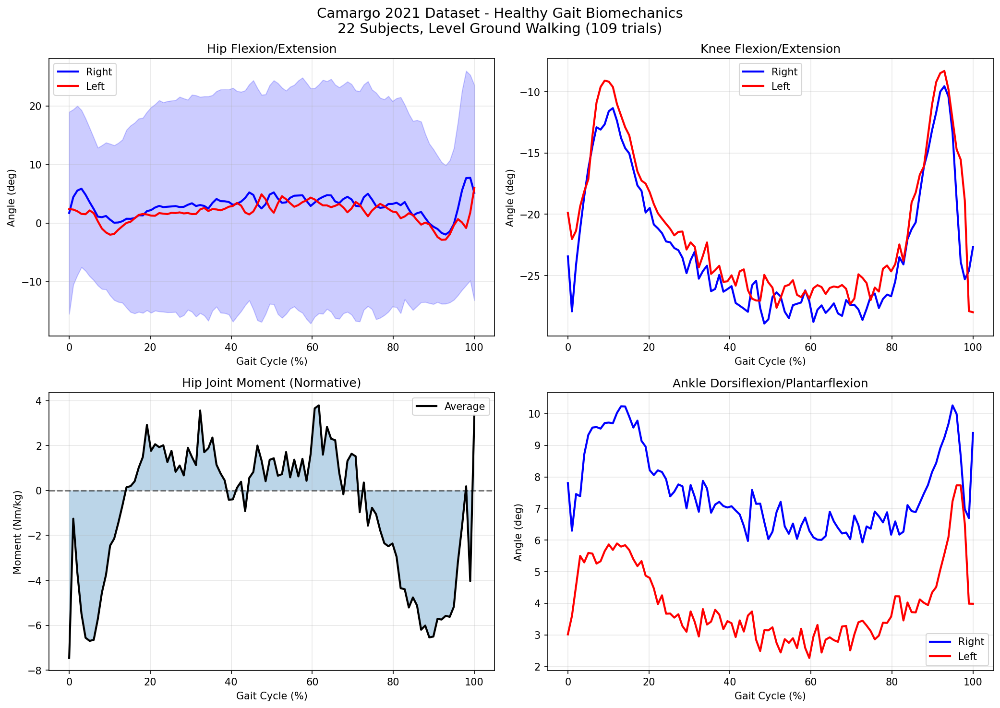
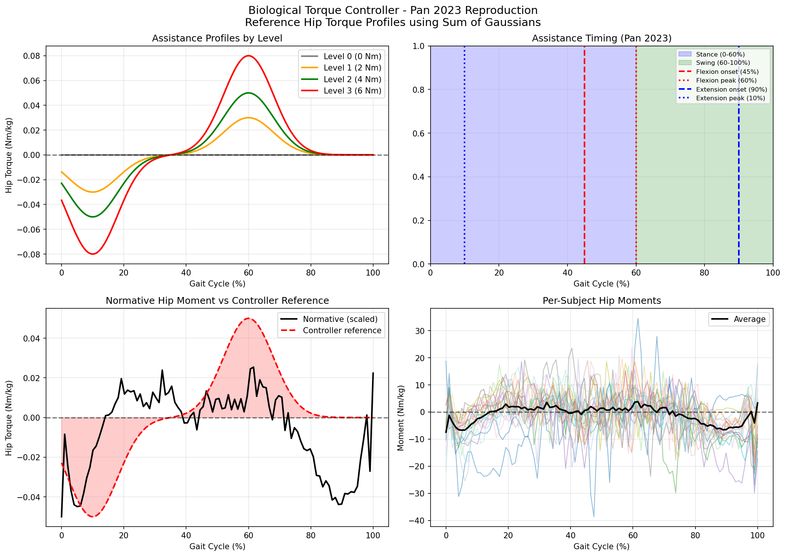
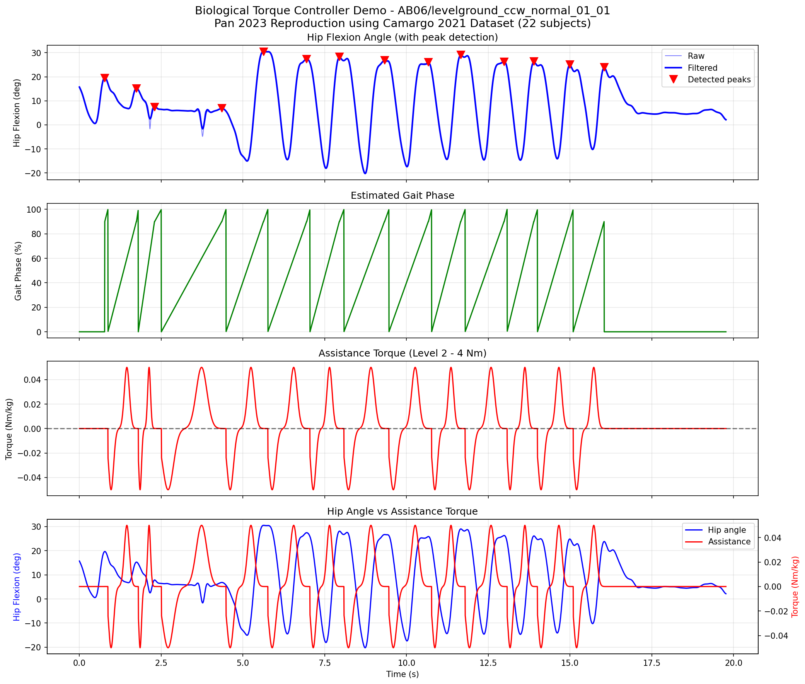

# 髋关节外骨骼 · 生物力矩控制器复现

基于 **Camargo 2021** 公开下肢生物力学数据集，复现 **Pan 2023** 与 **Kang 2021** 提出的髋关节外骨骼
**生物力矩控制器**（Biological Torque Controller）：先从健康人平地行走数据中提取归一化髋力矩，
再用高斯求和拟合出可调的辅助参考曲线，最后用髋角度峰值检测做在线步态相位估计并查表输出力矩。

> **本仓库是算法侧**。同一项目的机械/动力学侧（CAD → Simscape Multibody 多体动力学，arXiv:2609.15352）
> 见 👉 [hip-exoskeleton-dynamics](https://github.com/benny1232123/hip-exoskeleton-dynamics)。

---

## 两阶段结构

```
离线阶段：Camargo 数据集 → 归一化力矩 → 高斯拟合 → 可调参考曲线
在线阶段：髋关节角度    → 峰值检测   → 步态相位 → 查表输出力矩
```

---

## 目录结构

```
hip-exoskeleton-torque-control/
├── config.py                      # 统一路径解析 + 控制器常量（无硬编码绝对路径）
├── process_part1.py               # 步骤 1：抽取 Part 1 的平地行走 IK/ID 数据
├── process_part2_3_batch.py       # 步骤 2：批量抽取 Part 2/3 并合并为全量 CSV
├── pan2023_full_dataset.py        # 步骤 3：22 人全量复现 + 生成三张结果图
├── requirements.txt
├── LICENSE                        # MIT
├── archive/                       # 已废弃的早期脚本（仅留档，见 archive/README.md）
│   ├── pan2023_reproduction_v2.py
│   └── visualize_gait.py
└── processed/                     # 生成产物
    ├── gait_curves_all_subjects.png            # 图 1
    ├── biological_torque_controller_all.png    # 图 2
    ├── biological_torque_controller_demo_all.png  # 图 3
    └── *.csv                                   # ⚠️ 不入库，见 .gitignore
```

---

## 快速开始

### 1. 安装依赖

Python 3.9+。建议用虚拟环境：

```bash
python -m venv .venv
source .venv/bin/activate          # Windows: .venv\Scripts\activate
pip install -r requirements.txt
```

> `mat-io` 的 **pip 包名**是 `mat-io`，但 **import 名**是 `matio`，两者不一致，注意区分。
> 无显示器的机器（服务器 / CI）请追加 `export MPLBACKEND=Agg`。

依赖：`numpy`、`pandas`、`scipy`、`matplotlib`、`mat-io`。

### 2. 下载原始数据

原始数据集 **不在本仓库**（约 10 GB+）。从 Mendeley 下载 **Camargo et al. 2021**
*A comprehensive, open-source dataset of lower limb biomechanics* 的三个 Part，解压到仓库根目录：

| Part | 下载地址 |
|------|----------|
| Part 1 | https://data.mendeley.com/datasets/fcgm3chfff/1 |
| Part 2 | https://data.mendeley.com/datasets/k9kvm5tn3f/1 |
| Part 3 | https://data.mendeley.com/datasets/jj3r5f9pnf/1 |

```
Part1/  Part2/  Part3/          # 与仓库内已有脚本同级即可
```

数据集概况：22 名健康受试者（AB06–AB30），本项目**仅用平地行走（level ground walking）**数据，
IK/ID 采样率 200 Hz。

### 3. 依次跑完 pipeline

顺序不能乱——第 3 步依赖前两步产出的 CSV：

```bash
# 步骤 1：抽取 Part 1 → processed/levelground_part1.csv
python process_part1.py

# 步骤 2：抽取 Part 2/3 → levelground_part2.csv / levelground_part3.csv
#         并自动合并 → processed/levelground_all.csv
python process_part2_3_batch.py

# 步骤 3：22 人全量复现，生成三张图
python pan2023_full_dataset.py
```

⚠️ `processed/*.csv` 被 `.gitignore` 排除（`levelground_all.csv` 约 1.5 GB），**你必须本地生成**。
若直接跳过前两步跑第 3 步，脚本会报 `FileNotFoundError` 并提示先执行 pipeline。

---

## 路径配置（无需修改代码）

所有路径默认相对仓库根目录解析，优先级：**命令行参数 > 环境变量 > 仓库根**。

| 环境变量 | 含义 | 默认值 |
|----------|------|--------|
| `DATA_ROOT` | 含 `Part1/Part2/Part3` 的根目录 | 仓库根目录 |
| `GAIT_OUTPUT_DIR` | CSV 与图片输出目录 | `<repo>/processed` |
| `GAIT_PYTHON` | Part 2/3 批量读取子进程用的解释器 | 当前 `sys.executable` |

数据放在别处的常见用法：

```bash
python process_part1.py --data-root D:/data/camargo
export DATA_ROOT=D:/data/camargo && python pan2023_full_dataset.py
python pan2023_full_dataset.py --csv /nas/team/levelground_all.csv --output-dir ./figs
```

常用参数：`--level {0,1,2,3}`（演示图辅助等级，默认 2）、`--subject`（默认 AB06）、
`--show`（额外弹出窗口）、`--part {Part1,Part2,Part3}`。

---

## 复现结果

### 图 1：健康人步态生物力学曲线



22 名受试者平地行走的平均曲线。

| 子图 | 内容 | 说明 |
|------|------|------|
| 左上 | 髋关节屈曲/伸展角度 | 蓝=右腿，红=左腿，阴影为 ±1 标准差 |
| 右上 | 膝关节屈曲/伸展角度 | 单位：度 |
| 左下 | 髋关节力矩 | 正=屈曲，负=伸展，单位：Nm/kg |
| 右下 | 踝关节背屈/跖屈角度 | 单位：度 |

**关键数值**：髋关节力矩峰值屈曲 **3.79 Nm/kg @ 62%** 步态周期，
峰值伸展 **-7.46 Nm/kg @ 0%** 步态周期。

### 图 2：生物力矩控制器参数



| 子图 | 内容 | 说明 |
|------|------|------|
| 左上 | 4 个辅助等级的力矩曲线 | Level 0/1/2/3 ≈ 0/2/4/6 Nm |
| 右上 | 辅助时序图 | 蓝=支撑相(0–60%)，绿=摆动相(60–100%) |
| 左下 | 归一化髋力矩 vs 控制器参考曲线 | 黑=真实力矩，红虚线=高斯拟合 |
| 右下 | 22 人各自的髋力矩曲线 | 彩色=个人，黑粗线=平均 |

**高斯拟合参数**：屈曲辅助 μ=60%、σ=8%；伸展辅助 μ=10%、σ=8%；幅度 A 可调（0~0.08 Nm/kg）。

### 图 3：单试验在线控制演示



| 子图 | 内容 |
|------|------|
| 第 1 行 | 髋关节角度（蓝=滤波后，红三角=峰值检测） |
| 第 2 行 | 估计的步态相位（0–100% 锯齿波） |
| 第 3 行 | 实时计算的辅助力矩 |
| 第 4 行 | 髋角度与辅助力矩叠加 |

步态相位依据髋关节屈曲峰值估计：每个峰值对应步态周期 90%（足尖离地），相位在相邻峰值间线性插值。
辅助力矩在屈曲相（45–75%）施加正力矩，在伸展相（90–20%）施加负力矩。

---

## 算法原理

### 高斯求和

```python
τ(t) = A₁ · exp(-0.5 · ((t - μ₁) / σ₁)²)   # 屈曲辅助（正力矩），μ₁=60%, σ₁=8%
     + A₂ · exp(-0.5 · ((t - μ₂) / σ₂)²)   # 伸展辅助（负力矩），μ₂=10%, σ₂=8%
```

### 辅助等级

| 等级 | 幅度 A (Nm/kg) | 辅助力矩（按 75 kg 体重） | 用途 |
|------|----------------|---------------------------|------|
| Level 0 | 0.00 | 0 Nm | 无辅助（对照） |
| Level 1 | 0.03 | ≈ 2 Nm | 轻度辅助 |
| Level 2 | 0.05 | ≈ 4 Nm | 中度辅助 |
| Level 3 | 0.08 | ≈ 6 Nm | 重度辅助 |

上述常量集中在 `config.py`（`ASSISTANCE_LEVELS`、`FLEXION_GAUSSIAN`、`EXTENSION_GAUSSIAN`、
`TARGET_HZ` 等），改算法不需要碰各个脚本。

---

## 常见问题

**Q：为什么 clone 下来跑 `pan2023_full_dataset.py` 报缺少 CSV？**
A：中间 CSV 体量过大，不入版本库。先跑 `process_part1.py` 和 `process_part2_3_batch.py`。

**Q：原始数据必须放在仓库里吗？**
A：不必。用 `--data-root` 或 `DATA_ROOT` 指向任意位置均可，`Part1/` 等目录本身已被 gitignore。

**Q：`archive/` 里的脚本要跑吗？**
A：不要。那是 Part 1-only（约 7 人）的早期版本，功能已被 `pan2023_full_dataset.py` 完全覆盖，
保留仅为溯源。

---

## 参考文献

1. Camargo, J. et al. (2021). A comprehensive, open-source dataset of lower limb biomechanics. *Data in Brief*, 36, 107036.
2. Pan, Y. et al. (2023). Effects of Bilateral Assistance for Hemiparetic Gait Post-Stroke Using a Powered Hip Exoskeleton.
3. Kang, I. et al. (2021). Real-Time Gait Phase Estimation for Robotic Hip Exoskeleton Control During Multimodal Locomotion.

## License

MIT © 2026 benny1232123
